# herdr-mods

Mods for the [Herdr](https://herdr.dev) desktop app: a sidebar of spaces and agents, a launcher, a folder picker, machine and scheduler pages, nvim and lazygit side panels, and a Plugins page to switch all of it on and off.

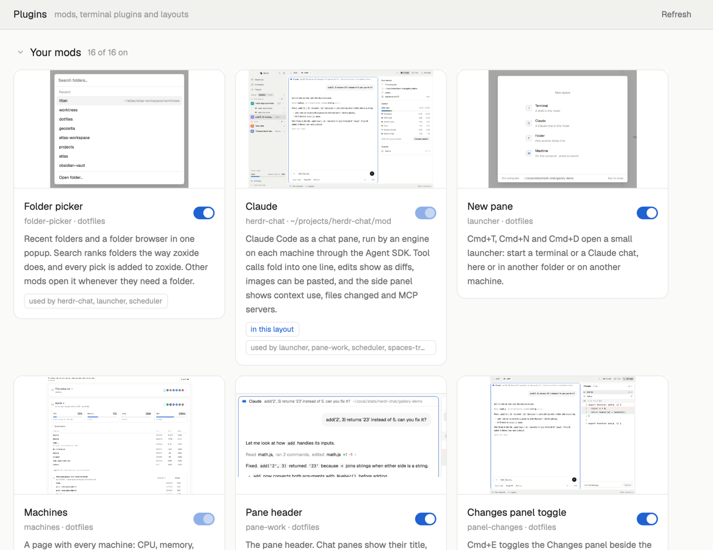

## Install

```sh
git clone https://github.com/eolweus/herdr-mods ~/herdr-plugins/herdr-mods
~/herdr-plugins/herdr-mods/install.sh
```

The script links each mod into `~/.config/herdr-app/mods` (or `$HERDR_APP_HOME/mods`), so `git pull` updates them, and adds a `workbench` layout that uses them. Switch to it with Ctrl+Shift+L. The shortcuts the mods expect, such as Cmd+T for the launcher, are in [`examples/keys.json`](examples/keys.json); merge the ones you want into `~/.config/herdr-app/keys.json`.

Some mods need other tools:

- **nvim sidebar** and **lazygit sidebar**: `nvim` and `lazygit` on your PATH.
- **Spaces and agents** shows board handoffs when [herdr-chat](https://github.com/eolweus/herdr-chat) is running; without it the handoff section stays empty.
- **Machines** and **Scheduler** reach other machines you've added to Herdr over ssh.

## Related

- [herdr-chat](https://github.com/eolweus/herdr-chat): Claude Code as a chat pane.
- [herdr-raycast](https://github.com/eolweus/herdr-raycast): a command palette for terminal Herdr.
- [herdr-nvim](https://github.com/eolweus/herdr-nvim): a full-height nvim sidebar for terminal Herdr.

## The mods

### Folder picker

`mods/folder-picker`. Recent folders and a folder browser in one popup. Search ranks folders the way zoxide does, and every pick is added to zoxide. Other mods open it whenever they need a folder.

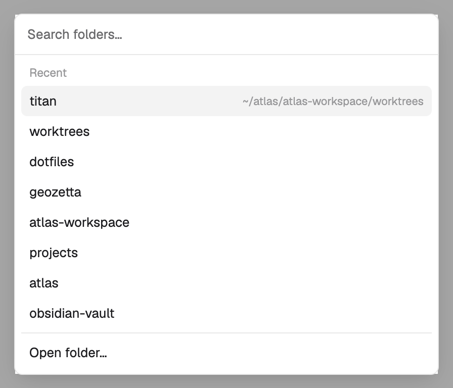

### New pane

`mods/launcher`. Cmd+T, Cmd+N and Cmd+D open a small launcher: start a terminal or a Claude chat, here or in another folder or on another machine.

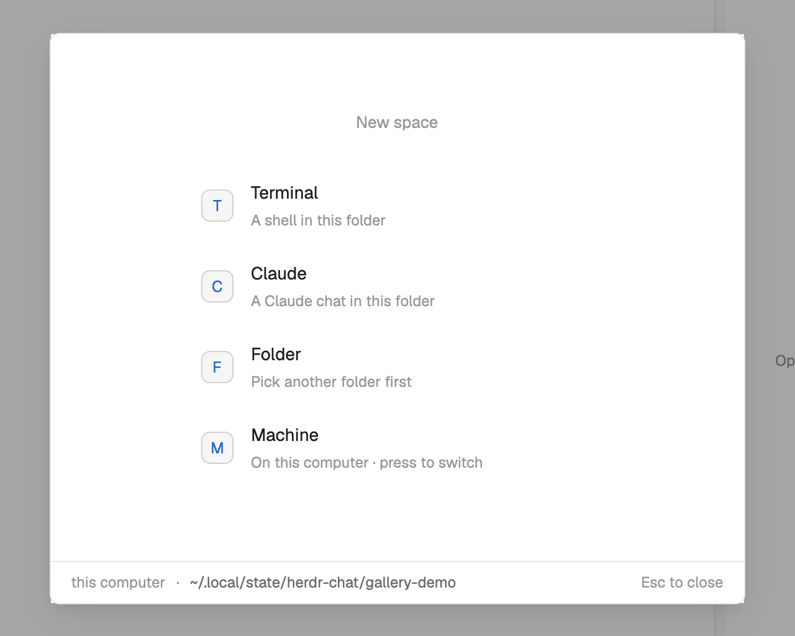

### Machines

`mods/machines`. A page with every machine: CPU, memory, swap and disk, the busiest processes, which agent started what, and listening ports you can click to open. Each machine can get a color that is used everywhere.

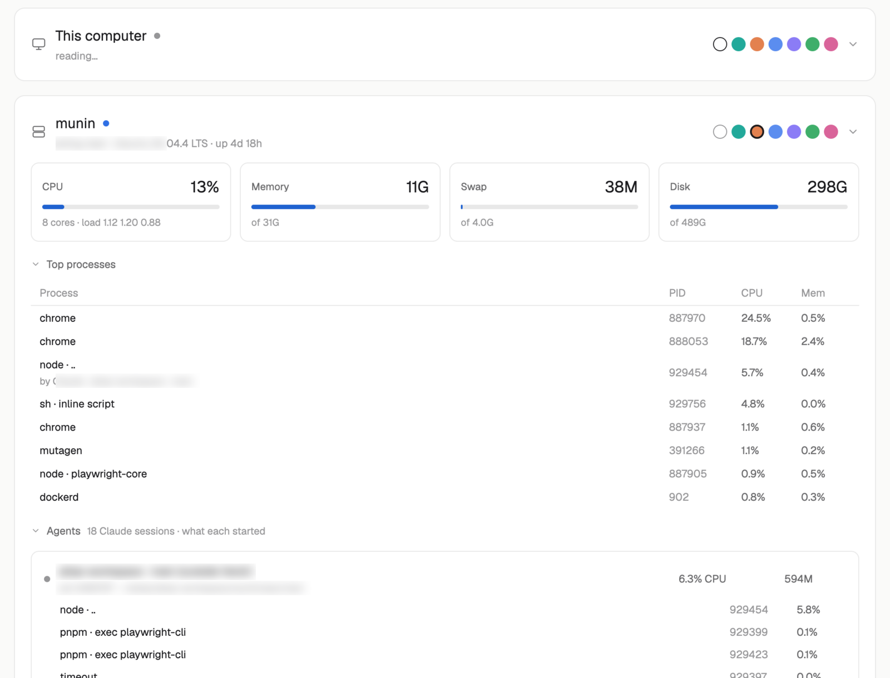

### Pane header

`mods/pane-work`. The pane header. Chat panes show their title, folder and status, and the edge takes the machine's color. Split, zoom and close buttons on the right.

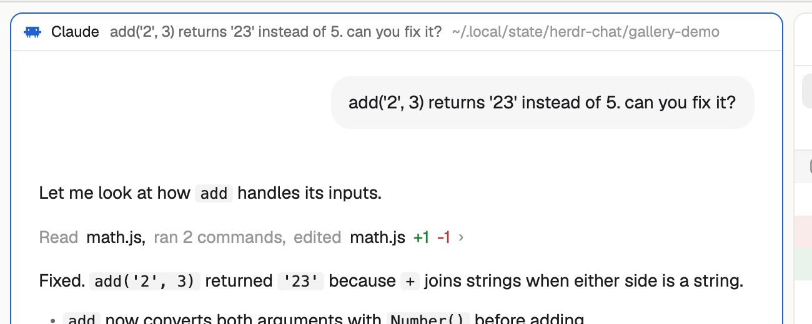

### Changes panel toggle

`mods/panel-changes`. Cmd+E toggles the Changes panel beside the work area: the git diff of the focused folder, with a commit box.

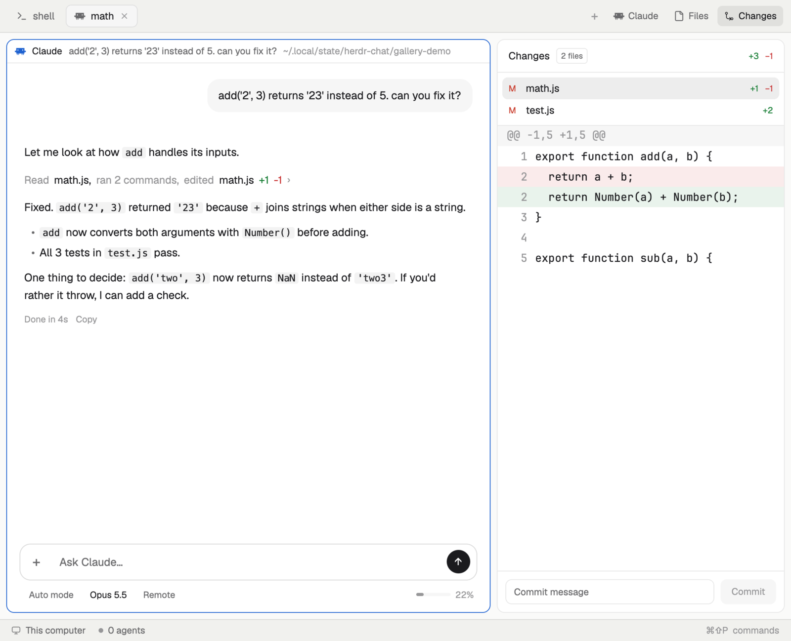

### Plugins

`mods/plugins`. This page: layouts, the parts of the current layout, your mods and terminal Herdr plugins, each with an on and off switch.


### Scheduler

`mods/scheduler`. One page for systemd timers, launchd agents, crontab entries and scheduled Claude runs on every machine. Run, pause, reschedule and group jobs, read their scripts and logs, or start a new Claude run.

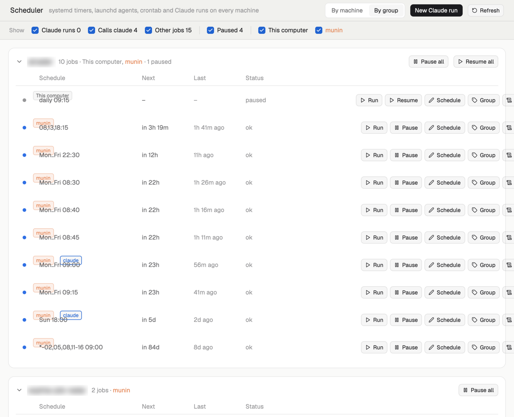

### lazygit sidebar

`mods/sidebar-lazygit`. Cmd+L opens lazygit beside the current tab, and closes it again. Each tab keeps its own.

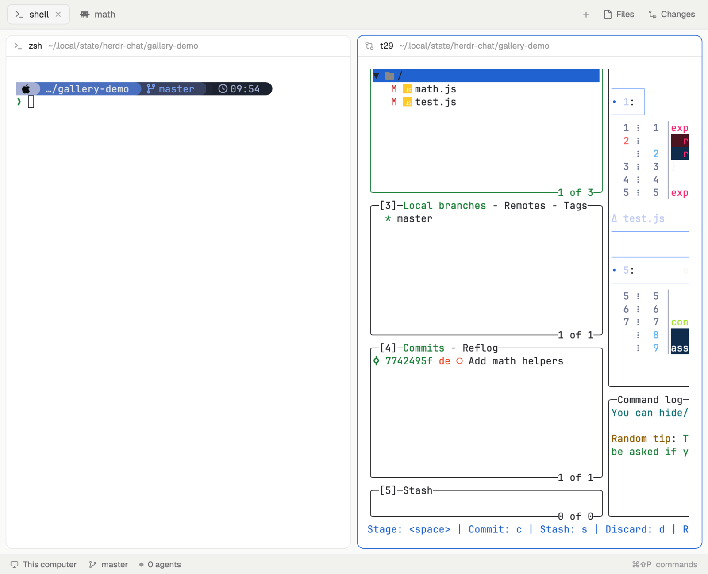

### Sidebar nav

`mods/sidebar-nav`. The links at the top of the sidebar to the Machines, Scheduler and Plugins pages.

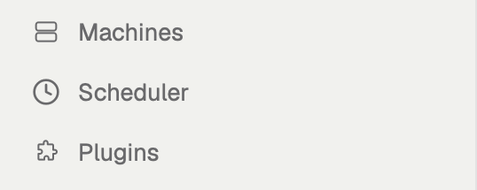

### nvim sidebar

`mods/sidebar-nvim`. Cmd+O opens nvim beside the current tab, and closes it again. Each tab keeps its own.

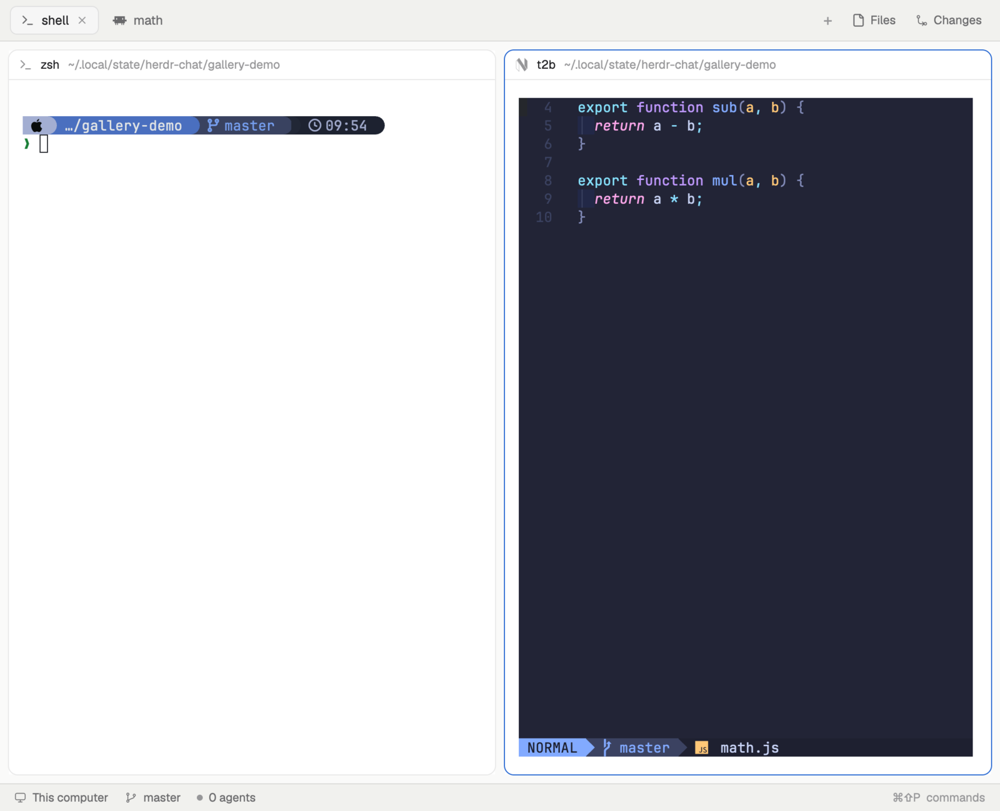

### space-sections

`mods/space-sections`. Right-click menus for the spaces list: gather spaces into named sections that fold, rename them and move spaces between them.

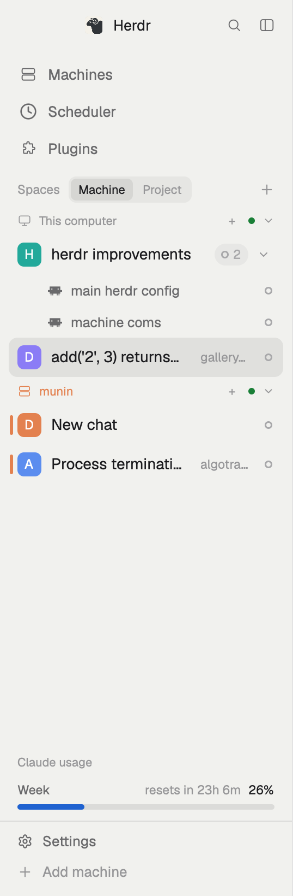

### Spaces and agents

`mods/spaces-tree`. The sidebar's spaces, with the agents and chats in each listed underneath, grouped by machine or by project. Status shows on each row, handoffs nest under the chat that sent them, and Ctrl+Alt+J/K steps through them.

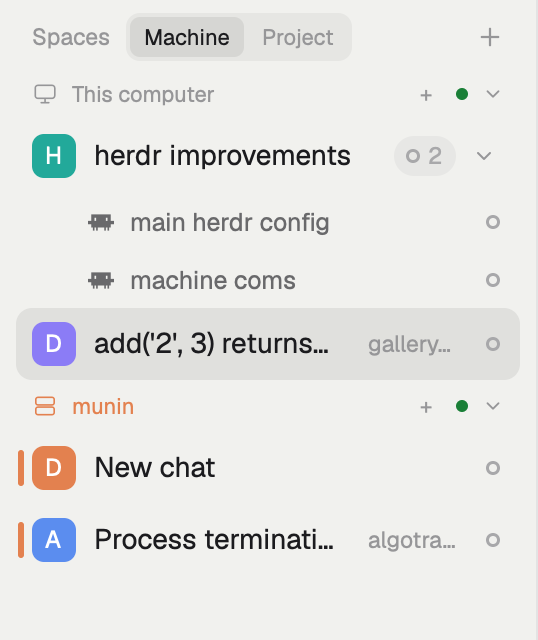

### Tabs

`mods/tabs-work`. The tab bar: tabs as pills, a + menu, the machine's color, and buttons for the Claude, Files and Changes panels.

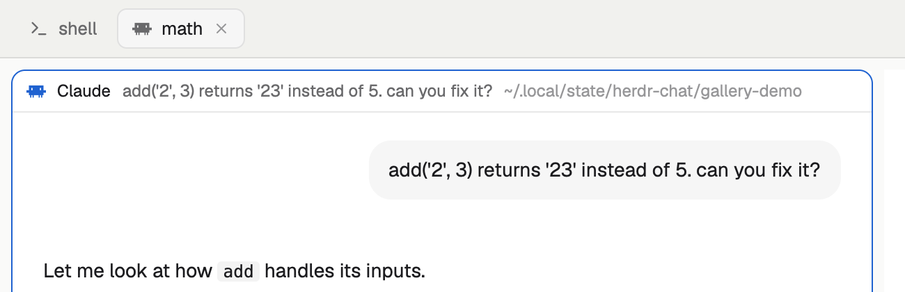

### toast-work

`mods/toast-work`. Notifications in the corner. Clicking one runs its action, such as opening the chat that finished, and leaves a full-page view to get there.

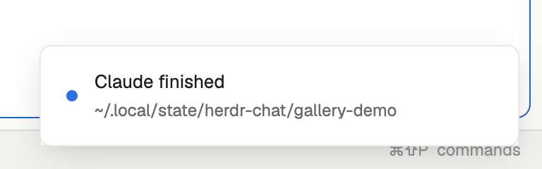

### Claude usage

`mods/usage`. Claude subscription use above the sidebar footer, a bar for each limit window and when it resets.

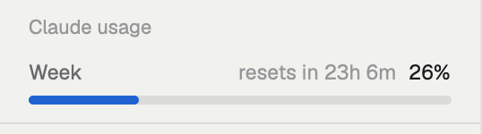
