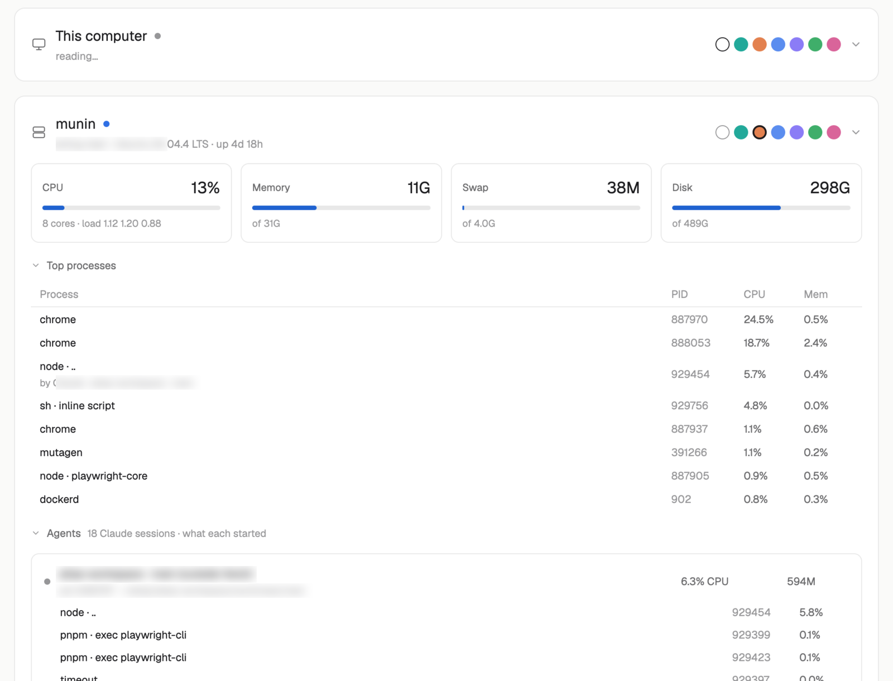

# Machines

A page with every machine: CPU, memory, swap and disk, the busiest processes, every running Claude session (where it runs, model, context, memory, when it was last active and what it started), and listening ports you can click to open. Each machine can get a color that is used everywhere.

